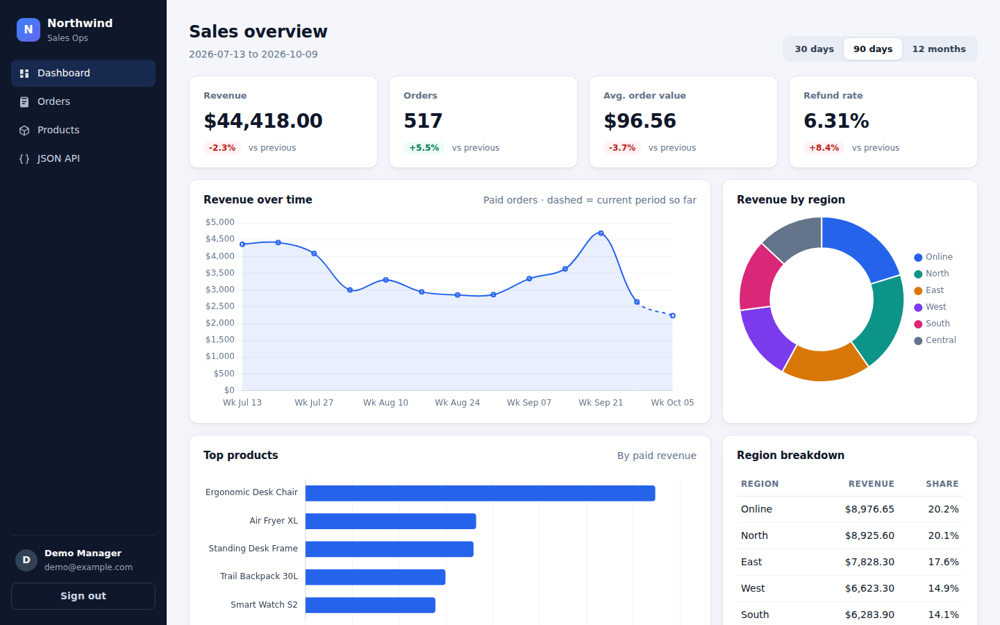
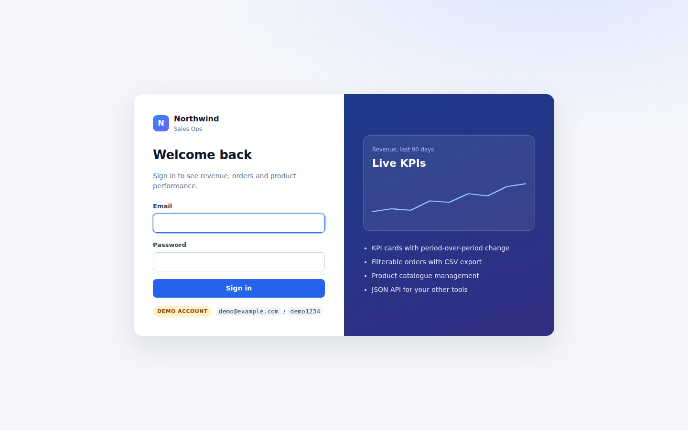
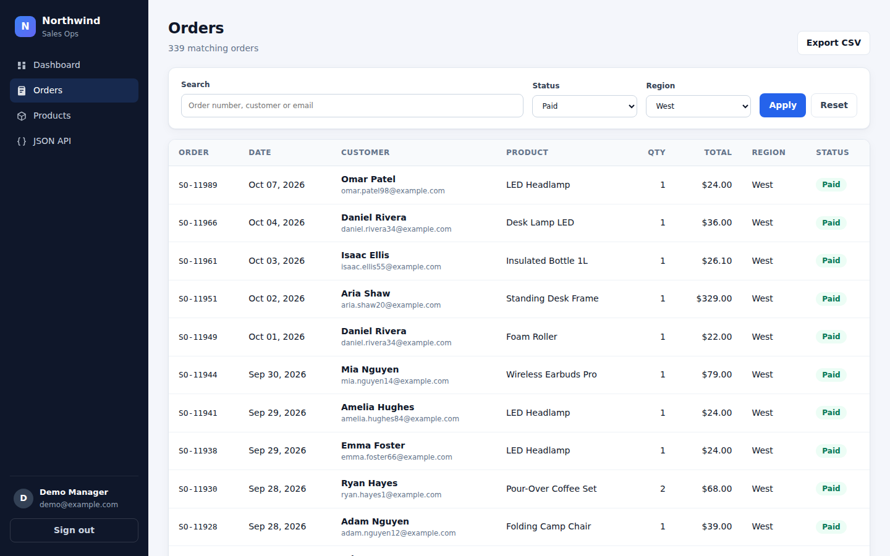
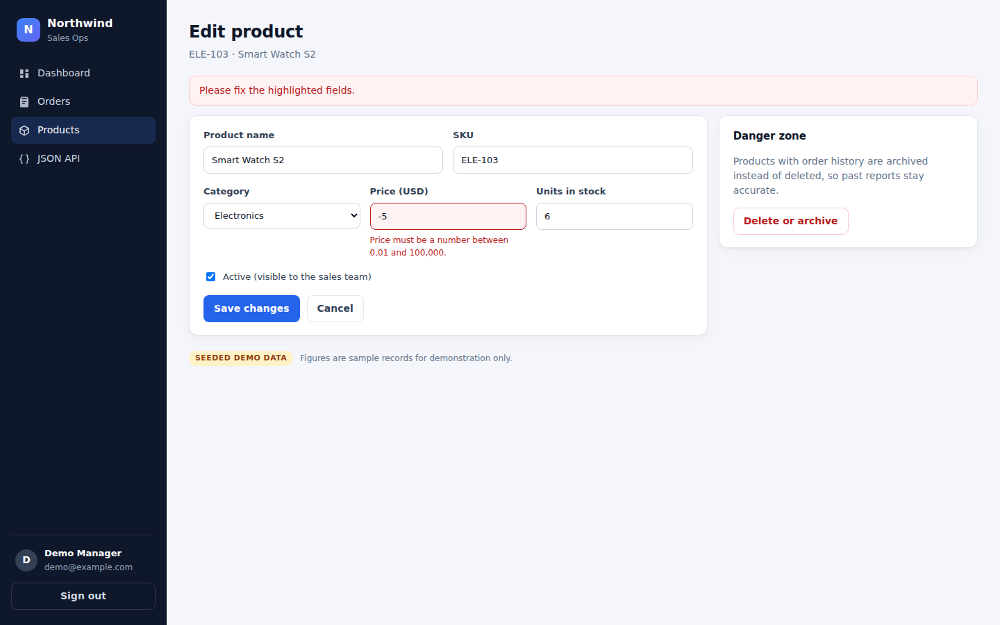

# Flask Sales Dashboard

A sales operations dashboard built with Flask and SQLite: KPI cards with period-over-period change, revenue charts, a filterable orders table with CSV export, product management and a JSON API.



> **Seeded demo data.** Every customer, order and figure in this repository comes from the `seed` command below (fixed random seed, `example.com` emails). Nothing here is real business data.

## Features

- **Dashboard** - revenue, orders, average order value and refund rate, each compared with the previous period of the same length; revenue over time (daily, weekly or monthly buckets), top products and revenue by region. Ranges: 30 days, 90 days, 12 months.
- **Orders** - search by order number, customer or email; filter by status and region; pagination; **CSV export of exactly the filtered set**.
- **Products** - create, edit and archive products with server-side validation and clear field errors. Products with order history are archived rather than deleted so past reports stay correct.
- **JSON API** - `GET /api/stats?range=90d` and `GET /api/orders?status=paid&region=West&page=1&per_page=50` for plugging the numbers into other tools.
- **Security basics** - hashed passwords (Werkzeug), session login, CSRF tokens on every form, open-redirect protection on `?next=`, `SECRET_KEY` required in production, secure + HttpOnly + SameSite cookies.
- **Tested** - 40 pytest tests covering auth, access control, the stats maths, filters, CSV export and product validation.

| Login | Orders (filtered) | Product validation |
|---|---|---|
|  |  |  |

## Quickstart

```bash
git clone https://github.com/Ali83128/flask-sales-dashboard.git
cd flask-sales-dashboard
python -m venv .venv && source .venv/bin/activate   # Windows: .venv\Scripts\activate
pip install -r requirements.txt

flask --app app seed      # creates instance/sales.db with demo data
flask --app app run --debug
```

Open http://127.0.0.1:5000 and sign in with **demo@example.com / demo1234**.

### Seed options

```bash
flask --app app seed --orders 5000 --seed 7
```

The seed builds 25 products in 5 categories, 150 customers across 6 regions and about 2,000 orders over the last 12 months, with a gentle growth trend, a Q4 lift, busier weekends and realistic status mix (mostly paid, some refunded, recent orders still pending).

## How the numbers are defined

| KPI | Definition |
|---|---|
| Revenue | Sum of `total` for **paid** orders in the window |
| Orders | All orders created in the window, any status |
| Avg. order value | Revenue / number of paid orders |
| Refund rate | Refunded / (paid + refunded) |
| Change vs previous | Same metric for the window of equal length immediately before. Shown only when stored data covers that earlier window - no inflated "+1000%" from a half-empty period. |

Windows start on a bucket boundary (midnight, Monday or the 1st of the month), so the first point on the chart is always a full period. The last point is the current period so far and is drawn dashed.

## Project structure

```
app/
  __init__.py      application factory, error handlers, `seed` CLI command
  config.py        development / production / testing settings
  models.py        User, Product, Customer, Order
  security.py      CSRF tokens, login_required, current user loader
  stats.py         KPI, time-series and breakdown queries
  filters.py       shared order filters (page, CSV export and API use the same code)
  auth.py  dashboard.py  orders.py  products.py  api.py   blueprints
  seed.py          deterministic demo data
  templates/  static/
tests/             pytest suite (in-memory SQLite)
scripts/screenshots.py   captures the README screenshots with Playwright
wsgi.py            gunicorn entry point
```

## Tests

```bash
pip install -r requirements-dev.txt
pytest -q
```

## Deployment

```bash
export APP_ENV=production
export SECRET_KEY="$(python -c 'import secrets; print(secrets.token_hex(32))')"
flask --app app seed            # or point DATABASE_URL at Postgres and load real data
gunicorn -w 3 -b 127.0.0.1:8000 wsgi:app
```

Put nginx in front for TLS and static files, and run gunicorn under systemd so it restarts on failure:

```nginx
server {
    server_name dashboard.example.com;
    location /static/ { alias /srv/flask-sales-dashboard/app/static/; expires 7d; }
    location / {
        proxy_pass http://127.0.0.1:8000;
        proxy_set_header Host $host;
        proxy_set_header X-Forwarded-For $proxy_add_x_forwarded_for;
        proxy_set_header X-Forwarded-Proto $scheme;
    }
}
```

Production mode refuses to start without `SECRET_KEY` and marks the session cookie `Secure`, so serve it over HTTPS.

## License

MIT - see [LICENSE](LICENSE).
